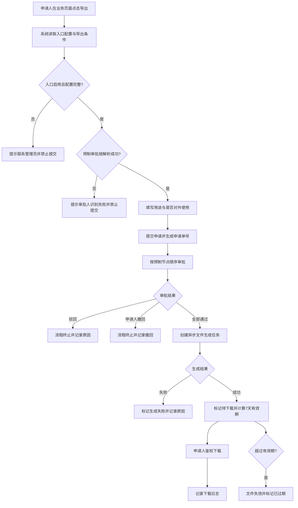

**智慧家庭数智平台下载中心软件产品需求 PRD（PMO视角）**

| 文档属性 | 内容 |
|---|---|
| 产品名称 | 智慧家庭数智平台——下载中心 |
| 一句话描述 | 面向企业内部数据导出场景，提供下载申请、分级审批、文件生成与领取、入口治理及审计追溯的一体化管理能力。 |
| 当前产品形态 | React + Vite 前端原型，当前业务数据及异步交互主要为模拟数据，尚需生产系统接口支撑。 |
| PRD范围基线 | 以 2026-07-16 项目主导航及“下载Demo”可见功能为准；隐藏的历史兼容页面不纳入本期核心范围。 |
| 目标版本 | V1.0（生产化版本） |
| 目标发布时间 | {{待确认：目标上线日期及灰度周期}} |
| 文档负责人 | {{待确认：产品经理或PMO姓名}} |
| 业务提出人 | {{待确认：业务提出人及所属部门}} |
| 技术负责人 | {{待确认：前端、后端及架构负责人}} |

# 1. 文档变更记录（必填）

| 版本 | 更新日期 | 变更类型 | 变更内容概述 | 变更人 | review状态 |
|---|---|---|---|---|---|
| v1.0 | 2026-07-16 | 新建 | 基于当前项目实现及已确认交互规则，形成PMO视角需求基线 | Codex（代拟） | 待 review |

# 2. 需求背景（必填）

## 2.1 产品基本信息与需求来源

本需求来源于智慧家庭数智平台的数据下载治理规划、现有前端原型以及需求方对页面和流程的连续评审反馈。当前原型已形成“发起下载申请—审批—生成文件—下载—审计”的完整可视化链路，但核心数据仍为前端模拟，尚未接入统一身份、组织架构、审批、文件生成、存储和审计数据源。

| 必填项 | 结论 |
|---|---|
| 需求来源 | 业务规划、原型评审、数据安全与下载审计治理诉求 |
| 是否与提出人确认 | 是，产品功能范围已通过本项目的连续交互反馈形成；量化收益、上线计划和责任人仍需正式 review |
| 是否符合产品规划 | {{待确认：智慧家庭数智平台产品接口人确认结果}} |
| 需求类型 | 新能力建设与原型生产化 |
| 目标用户 | 数据申请人、审批人、平台管理员、安全/审计人员 |

## 2.2 现状问题

1. 数据导出入口分散在各业务页面，缺少统一的入口标识、风险分级和审批开关管理。
2. 下载用途、是否对外使用、导出条件等上下文若不随申请固化，审批人难以准确判断数据使用风险。
3. 待审批与已审批若分散展示，审批人无法在一个列表中按状态检索和回看完整处理结果。
4. 审批通过后的文件生成、可下载、已下载、过期和失败状态需要统一追踪，避免用户反复询问处理进度。
5. 下载行为和入口配置变更若缺少统一审计记录，将无法满足安全追责、问题定位和合规检查要求。
6. 当前项目主要为前端原型，尚未形成真实接口、权限模型、数据埋点、监控告警及生产验收基线。

## 2.3 解决手段与定性目标

建设统一下载中心，围绕下载入口、申请、审批、文件、审计五类对象形成闭环治理：

1. 在业务页面的导出按钮上接入标准下载申请弹框，自动带入入口及导出条件上下文。
2. 使用系统预制审批链，申请人和管理员仅可预览，不开放自定义配置。
3. 将待审批和已审批整合为“我的审批”，通过审批状态区分处理结果，并在详情中展示完整申请内容和审批流程。
4. 审批通过后异步生成文件，文件自生成完成起保留最近7天，有效期内不限制下载次数。
5. 提供申请人、审批人和管理员三类查询视图，并以状态、风险等级和操作时间支持追踪。
6. 将下载日志与配置变更日志合并在同一审计表格，通过“操作类型”字段区分。

## 2.4 量化目标与验证方式

| 目标 | 目标值 | 验证方式 | 数据来源 |
|---|---:|---|---|
| 受控入口申请覆盖率 | 已启用审批的下载入口覆盖率 100% | 对比入口调用量与申请创建量 | 入口调用日志、申请表 |
| 审批过程可追溯率 | 100%的审批动作记录节点、操作人、结果、意见和时间 | 抽样审计及数据完整性校验 | 审批实例表、审批动作日志 |
| 下载行为可追溯率 | 成功和失败下载日志覆盖率 100% | 对比下载网关请求与审计日志 | 下载服务日志、审计日志 |
| 配置变更可追溯率 | 新建、编辑、启停、复制配置记录覆盖率 100% | 配置表变更与审计日志对账 | 配置库、审计日志 |
| 未审批绕过下载率 | 0 | 安全测试及下载凭证校验 | 下载鉴权日志 |
| 文件有效期执行准确率 | 100%按“生成完成时间+7×24小时”失效 | 定时抽检及自动化测试 | 文件元数据、过期任务日志 |
| 审批处理时效 | {{待确认：例如P90小于8个工作小时}} | 上线后按节点计算申请至完成耗时 | 审批实例表 |
| 用户使用规模 | {{待确认：预计日活、日均申请量、峰值并发量}} | 上线后第7天及第30天复盘 | 产品埋点、业务数据库 |

# 3. 需求价值或收益（必填）

## 3.1 业务价值

1. **降低数据外泄风险**：强制记录下载用途、外部使用标识及导出范围，并通过预制审批链完成风险复核。
2. **提升协作效率**：申请人可自行查看审批和文件状态，审批人在单页完成待办处理与历史回看，减少线下催办和状态询问。
3. **统一平台治理**：管理员可集中管理下载入口、风险等级、启停状态和审批开关，避免各业务系统重复建设。
4. **增强审计能力**：下载与配置变更均具备人员、时间、结果、IP及备注等审计字段，满足安全检查和问题追溯。
5. **支持跨团队交付**：通过统一状态机、验收标准和系统依赖，为后端、审批、存储和业务系统联调提供明确边界。

## 3.2 预估收益

| 收益项 | 预估目标 | 计算方式 | 确认状态 |
|---|---:|---|---|
| 人工登记与催办工时 | {{待确认：预计下降比例}} | （上线前月均工时-上线后月均工时）/上线前月均工时 | 待业务基线数据 |
| 审计取证时长 | {{待确认：例如从小时级降至10分钟内}} | 审计人员完成单次追溯的平均耗时 | 待安全团队确认 |
| 审批超时率 | {{待确认：目标下降比例}} | 超过SLA的申请数/全部已完成申请数 | 待SLA确认 |
| 下载违规事件 | 目标为0起未授权下载 | 未通过有效申请和鉴权仍成功下载的事件数 | 已形成原则目标 |
| 平台重复建设成本 | {{待确认：预计减少的重复开发与维护人天}} | 各系统复用统一能力节省的人天 | 待各业务系统评估 |

# 4. 功能拆分与使用场景（必填）

## 4.1 功能点拆分（必填）

| 涉及端/系统 | 功能模块 | 功能点描述 | 优先级 | 备注（依赖、约束等） |
|---|---|---|---|---|
| 业务系统/下载中心 | 下载入口接入 | 业务页面导出按钮调用标准申请弹框，并自动带入入口、页面、数据类型、风险等级及导出条件 | P0 | 依赖统一入口配置与业务页面SDK/组件接入 |
| 下载中心 | 下载申请 | 填写下载用途、是否对外使用和备注；预览审批链后提交 | P0 | 用途、是否对外使用必填；配置缺失或审批人解析失败时禁止提交 |
| 下载中心 | 我的申请 | 查询本人申请，查看审批、当前节点、文件状态；支持详情、合规下载和审批中撤回 | P0 | 仅待下载且文件有效时允许下载 |
| 下载中心 | 我的审批 | 待审批与已审批合并展示，通过审批状态筛选结果 | P0 | 详情页展示完整申请内容和全审批链 |
| 下载中心 | 审批处理 | 审批人通过或驳回；驳回必须填写原因；已处理记录只读 | P0 | 依赖审批引擎与组织架构 |
| 下载中心 | 申请详情 | 展示基本信息、用途、外部使用标识、导出条件、审批流程、文件状态及可用操作 | P0 | 状态与按钮必须严格匹配 |
| 下载中心/文件服务 | 文件生成与下载 | 审批完成后异步生成文件，展示生成中、待下载、已下载、过期、失败状态 | P0 | 文件保留7天；有效期内不限下载次数 |
| 管理后台 | 全部记录 | 管理员按申请人、状态、模块、风险、文件状态和时间查看全量申请 | P0 | 操作列仅保留“查看详情” |
| 管理后台 | 入口配置 | 新建、编辑、启停、复制入口；配置风险等级与审批开关 | P0 | 入口ID自动生成；所属模块为文本输入；审批链系统预制且只读预览 |
| 管理后台 | 审计日志 | 单表展示下载日志和配置变更日志，并以操作类型区分 | P0 | 不使用顶部Tab；需支持成功/失败、时间和人员筛选 |
| 平台框架 | 导航与身份 | 统一品牌头部、角色信息、主导航及下载中心快捷入口 | P1 | 通知功能不在本期范围 |
| 演示环境 | 下载Demo | 以销售订单导出场景演示申请弹框和审批链预览 | P2 | 演示功能仅保留该页面，不作为生产业务数据入口 |
| 交付工具 | 单文件分享 | 构建可离线打开的单HTML演示文件，覆盖全部保留页面和弹框 | P2 | 用于评审分享，不替代生产部署 |

## 4.2 用户使用场景或需求范围（必填）

| 用户角色 | 典型场景 | 目标结果 |
|---|---|---|
| 数据申请人 | 在销售报表中选择筛选条件后点击“导出数据”，核对系统带入的上下文，填写用途并提交 | 获得可追踪的下载申请，审批完成后在“我的申请”中下载文件 |
| 数据申请人 | 查看审批中申请的当前节点，发现范围不准确时撤回 | 流程及时终止，避免错误数据继续审批和生成 |
| 审批人 | 在“我的审批”中按“待审批”筛选，查看风险等级、是否对外使用、用途和数据量后处理 | 基于完整上下文做出通过或驳回决定 |
| 审批人 | 在同一列表回看已通过或已驳回记录 | 查看自己的审批意见、处理时间及完整审批流程 |
| 平台管理员 | 新建下载入口，系统生成入口ID，录入模块、页面、按钮、数据类型与风险等级，并预览预制审批链 | 将业务系统导出操作纳入统一治理 |
| 平台管理员 | 在“全部记录”定位生成失败或过期申请并进入详情 | 快速判断问题发生在审批、生成还是下载阶段 |
| 安全/审计人员 | 按申请单号、操作人、操作类型、结果和时间检索日志 | 还原一次下载或配置变更的责任人、时间、结果和来源IP |
| 评审人员 | 打开单文件演示或“下载Demo”体验完整申请弹框 | 无需部署后端即可完成产品走查与交互评审 |

**范围边界：**

- 本期核心范围为主导航中的“我的申请、我的审批、全部记录、入口配置、审计日志”及其详情/处理流程。
- 演示功能仅保留“下载Demo”。
- 消息通知、可配置审批链、文件有效期配置、下载次数限制配置、草稿保存、管理员重试生成均不在本期范围。
- 隐藏的历史兼容路由、通用资源申请、数据表权限和模型部署等旧原型能力不纳入本PRD。

## 4.3 涉及系统与关联需求（必填）

| 关联系统 | 关联方类型 | 关联内容/改动点简述 | 对应需求文档链接 | 产品经理 | 备注 |
|---|---|---|---|---|---|
| 统一身份与权限中心 | 内部系统 | 提供登录身份、角色、数据权限和管理员权限校验 | {{待确认：文档链接}} | {{待确认}} | 未授权访问全部记录、入口配置和审计日志时需拒绝 |
| 组织架构/通讯录 | 内部系统 | 提供部门、直属主管、业务负责人及安全审批组解析 | {{待确认：文档链接}} | {{待确认}} | 节点解析失败时禁止提交申请 |
| 审批引擎 | 内部系统 | 创建审批实例、推进预制节点、记录意见与结果、回调流程状态 | {{待确认：文档链接}} | {{待确认}} | 需支持撤回、通过、驳回及幂等回调 |
| 业务数据系统 | 内部系统 | 接入下载按钮，传递入口ID、查询条件、预计数据量和导出字段 | {{待确认：首批接入系统清单}} | {{待确认}} | 首批范围需逐系统确认 |
| 文件生成服务 | 内部系统 | 根据审批通过的申请异步生成文件并回传状态、大小和失败原因 | {{待确认：文档链接}} | {{待确认}} | 生成任务必须幂等，禁止前端直接拼接下载地址 |
| 对象存储/下载网关 | 内部系统 | 存储文件、签发短期下载凭证、执行7天过期和下载鉴权 | {{待确认：文档链接}} | {{待确认}} | 有效期内不限制下载次数，但每次下载均需鉴权和记日志 |
| 日志与监控平台 | 内部系统 | 接收业务日志、审计日志、指标和告警 | {{待确认：文档链接}} | {{待确认}} | 审计日志应防篡改并满足保留周期要求 |
| 数据分析平台 | 内部系统 | 汇总申请、审批、生成、下载和配置变更指标 | {{待确认：文档链接}} | {{待确认}} | 用于上线效果复盘 |

# 5. 需求详情（必填）

## 5.1 整体业务流程（必填）

### 5.1.1 正向流程

1. 业务页面通过入口ID调用统一下载申请能力。
2. 系统加载入口名称、模块、页面、按钮、数据类型、风险等级及导出条件摘要。
3. 系统校验入口状态、审批开关和预制审批链解析结果。
4. 申请人填写下载用途、是否对外使用，可选填备注后提交。
5. 系统生成全局唯一申请单号，按预制审批链依次流转。
6. 全部节点通过后创建文件生成任务；生成成功后状态变为“待下载”。
7. 申请人在7天有效期内可不限次数下载，每次下载均重新鉴权并记录审计日志。
8. 到期后文件不可继续下载，申请及审计记录仍保留。

### 5.1.2 逆向与异常流程

1. 审批中申请可由申请人撤回；撤回后流程立即终止，不能恢复，只能重新提交。
2. 任一审批节点驳回后流程终止，必须记录驳回原因；申请人可参考旧申请重新发起。
3. 入口未配置、入口已停用或审批人解析失败时，申请弹框可展示上下文但禁止提交。
4. 文件生成失败时保留失败原因和状态，不在“全部记录”提供管理员手工重试入口；后续恢复策略由服务端自动重试或重新申请，需技术方案明确。
5. 文件过期后任何下载请求均返回明确的过期提示并写入失败下载日志。
6. 重复提交、重复审批回调和重复生成回调必须通过幂等键处理，禁止生成重复审批动作或重复任务。

### 5.1.3 状态模型

| 对象 | 状态 | 进入条件 | 可执行操作 | 退出条件 |
|---|---|---|---|---|
| 申请 | 审批中 | 申请提交成功 | 查看详情、撤回 | 全部通过、任一驳回或撤回 |
| 申请 | 已驳回 | 任一节点驳回 | 查看详情、参考旧申请重提 | 终态 |
| 申请 | 审批通过 | 全部节点通过 | 查看详情 | 文件生成任务创建 |
| 申请 | 文件生成中 | 生成任务已创建 | 查看详情 | 生成成功或失败 |
| 申请 | 待下载 | 文件生成成功且未过期 | 查看详情、下载 | 首次下载或到期 |
| 申请 | 已下载 | 至少成功下载一次且文件未过期 | 查看详情、再次下载 | 到期 |
| 申请 | 已过期 | 当前时间超过生成完成时间7×24小时 | 查看详情 | 终态 |
| 申请 | 生成失败 | 文件服务返回失败 | 查看详情 | {{待确认：服务端自动重试或重新申请策略}} |
| 审批节点 | 待处理 | 前置节点未完成 | 无 | 前置节点通过后成为当前节点 |
| 审批节点 | 审批中 | 成为当前节点 | 通过、驳回 | 操作提交成功 |
| 审批节点 | 已通过 | 审批人通过 | 查看 | 终态 |
| 审批节点 | 已驳回 | 审批人驳回 | 查看 | 终态并终止后续节点 |

## 5.2 功能详细说明（必填）

### 5.2.1 平台框架与导航

**功能概述：** 提供统一的智慧家庭数智平台头部和下载中心工作区导航。

**页面与交互规则：**

1. 头部背景色为 `#3069e6`，产品名称固定展示“智慧家庭数智平台”，文字和图标使用白色体系。
2. 头部右侧展示下载图标快捷入口，点击进入“我的申请”；不提供消息通知功能。
3. 左侧主导航依次为“我的申请、我的审批、全部记录、入口配置、审计日志”。
4. “演示功能”默认收起，展开后仅展示“下载Demo”。
5. 当前导航项和审批详情回退路径需保持高亮及路径一致。
6. “全部记录、入口配置、审计日志”仅对具备相应权限的管理员或审计角色开放。

### 5.2.2 下载申请弹框

**功能概述：** 将业务页面当前导出上下文固化到申请，降低申请人与审批人的信息差。

**字段与规则：**

| 区域/字段 | 来源 | 必填 | 规则 |
|---|---|---:|---|
| 入口名称、入口ID、所属模块、页面名称、按钮名称、数据类型、风险等级 | 入口配置 | 是 | 只读展示，不允许申请人修改 |
| 导出条件摘要 | 业务页面 | 是 | 包含时间范围、筛选条件、记录数或敏感字段提示；提交时固化快照 |
| 下载用途 | 申请人 | 是 | 不能为空白字符；{{待确认：最小/最大长度}} |
| 是否对外使用 | 申请人 | 是 | 选项为“仅内部使用”或“对外使用” |
| 备注 | 申请人 | 否 | {{待确认：最大长度}} |
| 审批流程预览 | 系统 | 是 | 仅预览系统预制节点，不可编辑 |

**异常处理：**

- 入口配置缺失时提示“当前入口未完成审批配置，请联系管理员”，提交按钮禁用。
- 任一审批节点无法解析时提示“审批人识别失败”，提交按钮禁用。
- 提交中按钮进入加载态并防止重复点击。
- 提交成功后关闭弹框并引导用户前往“我的申请”查看进度。

### 5.2.3 我的申请

**功能概述：** 申请人集中查询本人全部下载申请及文件状态。

**查询条件：** 申请单号、审批状态、入口名称、申请日期；支持查询与重置。

**表格字段：** 申请单号、入口名称、所属模块、申请时间、当前状态、当前节点、文件状态、操作。

**操作规则：**

1. 所有记录均可查看详情。
2. 仅“审批中”且未进入不可撤回节点的申请展示“撤回”；撤回前二次确认，并明确操作不可恢复。
3. 下载按钮可在审批通过后的文件阶段展示，但仅文件状态为“待下载/可下载”且未过期时可点击。
4. 已下载文件在7天有效期内仍允许再次下载；当前原型按钮可用性需在生产实现时与该规则统一。
5. 空数据、加载中、加载失败均需有独立反馈，失败状态支持重新加载。

### 5.2.4 我的审批

**功能概述：** 将待审批和已审批记录合并到同一页面，以状态筛选结果。

**查询条件：** 申请单号、申请人、入口名称、审批状态（全部、待审批、审批通过、已驳回）。

**表格字段：** 申请单号、申请人、部门、模块、入口名称、风险等级、审批状态、当前节点、更新时间、操作。

**业务规则：**

1. 新到待办可显示“新”标识，待办数量可在左侧导航显示角标；数量须来自实时待办接口。
2. 操作列仅展示“查看详情”。
3. 待审批详情进入可处理态；审批通过或已驳回详情进入只读态。
4. 审批状态是区分待办与已办的唯一主维度，不再通过两个页面或顶部指标卡拆分。

### 5.2.5 审批详情与决策

**功能概述：** 为审批人提供完整申请上下文、导出条件、审批流程及决策操作。

**展示内容：**

- 申请人、所属部门、申请时间、是否对外使用。
- 入口名称、所属模块/页面、风险等级、用途说明及补充说明。
- 导出时间范围、筛选条件、预计记录数。
- 全部审批节点的节点名称、审批人、状态、意见及处理时间。

**决策规则：**

1. “通过”允许审批意见为空；为空时系统默认意见为“同意”。
2. “驳回”必须填写明确原因，否则阻止提交并提示错误。
3. 提交中禁用所有操作，提交成功后提示并返回“我的审批”。
4. 已通过或已驳回记录只读展示本人的审批结果、意见和处理时间，不再展示决策按钮。
5. 同一节点的重复操作必须由服务端以版本号或幂等键拒绝，并提示“该审批已被处理”。

### 5.2.6 申请详情与文件状态

**功能概述：** 为申请人及管理员提供申请全景视图。

**展示内容：** 基本信息、下载用途、是否对外使用、备注、导出条件、审批流程、文件状态、文件大小、下载时间及失败原因。

**状态操作映射：**

| 申请/文件状态 | 操作 |
|---|---|
| 审批中 | 允许申请人撤回；管理员和审批人仅查看 |
| 已驳回 | 可参考原申请重新发起；不得直接生成文件 |
| 文件生成中 | 仅展示进度提示，不提供下载 |
| 待下载/有效期内已下载 | 允许鉴权下载 |
| 已过期 | 禁止下载，提示超过系统保留期限 |
| 生成失败 | 展示可理解的失败原因，不提供管理员手工“重新生成”按钮 |

### 5.2.7 全部记录

**功能概述：** 管理员查看平台全量申请及最新处理状态。

**筛选条件：** 申请单号/申请人、审批状态、模块、风险等级、文件状态、时间范围。

**表格字段：** 申请单号、申请人、部门、模块、入口名称、风险等级、审批状态、文件状态、最近操作时间、操作人、操作。

**规则：**

1. 操作列只保留“查看详情”，不提供查看日志、重试生成或其他快捷操作。
2. 生成失败记录可通过颜色提示，但不得改变其数据排序或隐式触发重试。
3. 无权限时展示权限不足页，不返回任何业务数据。
4. 查询和导出全量记录的权限需拆分，{{待确认：本期是否提供管理员列表导出}}。

### 5.2.8 入口配置

**功能概述：** 对各业务系统的下载入口进行统一登记和启停管理。

**列表能力：** 按模块、风险等级、状态、是否启用审批筛选；展示入口ID、名称、模块、页面、数据类型、风险、审批开关和状态；支持新建、编辑、启停、复制。

**编辑规则：**

| 字段 | 必填 | 编辑规则 |
|---|---:|---|
| 入口ID | 是 | 系统自动生成，全局唯一，新建和编辑均不可手工修改 |
| 入口名称 | 是 | 文本输入，{{待确认：唯一性范围及长度}} |
| 所属模块 | 是 | 文本输入，不使用固定下拉选项 |
| 所属页面 | 是 | 文本输入 |
| 按钮名称 | 是 | 文本输入 |
| 数据类型 | 是 | 文本输入 |
| 风险等级 | 是 | 低、中、高三级 |
| 状态 | 是 | 启用、停用 |
| 启用审批 | 是 | 开启后下载必须经过预制审批链 |

**审批规则：**

1. 审批链由系统预制，入口配置中只能预览，不能新增、删除、拖拽或修改节点。
2. 当前原型存在第二节点“部门负责人/功能负责人”命名不一致，生产基线统一为“业务负责人”占位；`{{待确认：最终节点名称及解析规则}}`。
3. 预制链建议为“直属主管→业务负责人→安全审批组”；是否按风险等级跳过或增加节点需另行评审。
4. 不提供文件有效期和下载次数配置；系统统一保留7天，有效期内不限下载次数。
5. 不提供保存草稿，仅支持“取消”和“保存并启用”。

### 5.2.9 文件生成与下载

**功能概述：** 在审批通过后安全、异步地生成并交付文件。

**业务规则：**

1. 文件生成任务必须以申请单号作为幂等键，同一申请最多存在一个有效生成任务。
2. 生成服务返回任务状态、文件大小、完成时间、失败码和失败描述。
3. 文件有效期从生成完成时间起计算7×24小时；过期任务应删除或冻结文件并更新业务状态。
4. 有效期内不限制下载次数，每次下载均校验申请归属、用户身份、文件有效期和下载权限。
5. 下载地址使用短期签名，不在前端长期暴露对象存储真实地址。
6. 每次下载成功或失败均记录申请单号、入口、申请人、操作人、结果、时间、备注和IP地址。
7. 文件生成失败的自动重试次数、间隔和人工处置方式为 `{{待确认：文件服务技术策略}}`。

### 5.2.10 审计日志

**功能概述：** 为安全和管理员提供统一、可筛选的关键操作记录。

**日志范围：** 仅包含“下载日志”和“配置变更”两类；通过表格“操作类型”字段区分，不使用顶部Tab。

**筛选条件：** 申请单号、入口名称、操作人、操作类型、操作结果、时间范围。

**表格字段：** 申请单号、入口名称、申请人、操作人、操作类型、操作内容、操作结果、操作时间、备注、IP地址。

**规则：**

1. 下载失败也必须记录，包括文件过期、无权限、签名失效和服务异常。
2. 配置变更应记录新建、编辑、启用、停用和复制，并保存变更前后差异；当前列表可仅展示摘要，详情能力 `{{待确认：是否纳入V1.0}}`。
3. 普通用户不得访问审计日志；管理员与审计角色的可见范围需按权限模型控制。
4. 审计日志禁止业务端修改或删除，保留周期为 `{{待确认：安全与合规要求，建议不少于180天}}`。

### 5.2.11 下载Demo与单文件分享

1. 演示模块仅保留“下载Demo”，展示销售订单列表、总金额及“导出数据”按钮。
2. 点击按钮打开与生产交互一致的下载申请弹框，演示高风险数据、导出条件摘要和三段式预制审批链。
3. 单文件分享版应将脚本、样式和所需静态资源内嵌，直接打开后默认进入首页，并可访问所有保留页面、子页面和弹框。
4. 演示数据须明确为模拟数据，不得与生产数据或真实客户信息混用。

## 5.3 非功能性需求

### 5.3.1 性能要求（必填）

| 指标 | 要求 | 验证方式 |
|---|---:|---|
| 首屏可交互时间 | 内网标准办公环境下P90 ≤ 2秒 | 浏览器性能测试 |
| 页面切换时间 | P90 ≤ 1秒 | 前端性能埋点 |
| 列表查询接口 | P95 ≤ 1秒，P99 ≤ 2秒 | 压测报告与APM |
| 详情查询接口 | P95 ≤ 800毫秒 | 压测报告与APM |
| 提交申请/审批接口 | P95 ≤ 1.5秒，不含异步文件生成 | 压测报告 |
| 文件生成 | 按数据量分级；{{待确认：10万、100万记录对应SLA}} | 文件服务压测 |
| 并发能力 | {{待确认：峰值在线用户、查询QPS、提交TPS}} | 容量评估及压测 |
| 功能日活 | {{待确认：首批接入人数及预计DAU}} | 上线后埋点统计 |

### 5.3.2 数据需求（如涉及必填）

**数据埋点事件：**

| 事件名 | 触发时机 | 关键字段 |
|---|---|---|
| `download_apply_open` | 打开下载申请弹框 | user_id、entry_id、module、risk_level |
| `download_apply_submit` | 申请提交结果返回 | request_id、entry_id、external_use、result、error_code |
| `approval_action` | 审批通过或驳回 | request_id、node_id、approver_id、decision、duration |
| `application_withdraw` | 申请撤回 | request_id、current_node、result |
| `file_generate_result` | 文件生成完成或失败 | request_id、file_size、duration、result、error_code |
| `file_download` | 下载请求完成 | request_id、operator_id、result、file_age、error_code |
| `entry_config_change` | 入口配置发生变更 | entry_id、action、operator_id、change_fields、result |

**统计指标与口径：**

1. 申请提交成功率 = 成功创建申请数 / 点击提交次数。
2. 审批通过率 = 审批通过申请数 / 已完成审批申请数。
3. 审批处理时长 = 当前节点完成时间 - 当前节点到达时间，按节点和风险等级统计P50/P90。
4. 文件生成成功率 = 生成成功任务数 / 已结束生成任务数。
5. 下载成功率 = 成功下载请求数 / 全部下载请求数。
6. 入口覆盖率 = 有有效入口配置且通过统一组件调用的导出次数 / 全部识别到的导出次数。

**效果评估计划：** 上线后第7天检查稳定性和流程漏斗，第30天对比上线前人工审批/登记基线，第90天进行安全审计和收益复盘。具体负责人为 `{{待确认：数据分析负责人}}`。

### 5.3.3 日志与监控（如涉及必填）

| 监控项 | 指标/日志 | 建议告警阈值 |
|---|---|---|
| 申请创建 | 成功率、接口耗时、重复提交数 | 5分钟成功率 < 99.5% 或P95 > 1.5秒 |
| 审批回调 | 回调成功率、幂等冲突、积压量 | 连续5分钟失败率 > 1%或积压 > {{待确认}} |
| 审批人解析 | 解析失败率、失败节点 | 15分钟失败率 > 2% |
| 文件生成 | 成功率、平均耗时、队列积压 | 15分钟成功率 < 98%或队列积压 > {{待确认}} |
| 文件过期任务 | 应过期数、实际处理数、延迟 | 过期处理延迟 > 30分钟 |
| 文件下载 | 成功率、鉴权失败率、流量 | 5分钟成功率 < 99%或异常流量超过基线 |
| 审计日志 | 写入成功率、消费延迟 | 写入成功率 < 99.99%或延迟 > 5分钟 |
| 配置变更 | 高频启停、批量变更、失败率 | 单用户10分钟内变更 > {{待确认}} 次 |

所有服务日志需携带 `trace_id`、`request_id`、`entry_id` 和操作者身份，敏感用途文本不得明文输出到普通应用日志。

### 5.3.4 安全与权限要求

1. 采用统一身份认证，所有接口由服务端校验身份和角色，前端隐藏按钮不作为权限控制依据。
2. 申请人仅可查看和下载本人申请；审批人仅可访问分配给本人或已由本人处理的审批；管理员权限按组织或全局范围配置。
3. 外部使用标识、风险等级和导出条件必须写入不可变申请快照，防止审批后篡改。
4. 文件存储与传输需加密，下载凭证短期有效并绑定用户和申请。
5. 入口配置、审批动作和下载行为均需审计；审计记录防篡改，敏感字段按最小必要原则展示。
6. 对高风险或对外使用申请是否强制经过安全审批组为 `{{待确认：安全策略}}`。
7. 需完成越权访问、重放下载、过期凭证、参数篡改、批量爬取和审计日志注入测试。

### 5.3.5 兼容性与可用性要求

1. 支持企业当前标准桌面浏览器最近两个主版本：Chrome、Edge；Safari支持范围 `{{待确认}}`。
2. 设计基线为桌面管理端，最小支持宽度建议1280px；移动端适配不纳入V1.0。
3. 表单错误应在字段附近明确说明，加载、空、错误、无权限和提交中状态均需可辨识。
4. 关键操作支持键盘聚焦，图标按钮提供可访问名称，状态不能仅依赖颜色区分。
5. 单文件演示版应在无网络环境下可打开；生产版不得依赖该文件承载真实业务。

# 6. 需求验收标准（如涉及必填）

## 6.1 功能验收

| 验收类型 | 验收项目 | 验收标准/条件 | 验收方式 |
|---|---|---|---|
| 功能验收 | 下载申请上下文 | 从已配置入口打开弹框时，入口、页面、按钮、数据类型、风险和导出条件与业务页面一致且只读 | 联调演示+接口校验 |
| 功能验收 | 申请表单 | 用途或是否对外使用为空时不得提交；补全后仅创建一张申请单 | 自动化测试+演示 |
| 功能验收 | 配置/解析异常 | 入口缺失、停用或审批人解析失败时展示明确原因并禁用提交 | 异常注入测试 |
| 功能验收 | 我的申请 | 可按申请单号、状态、入口和日期检索；表格准确展示审批和文件状态 | 测试用例 |
| 功能验收 | 撤回申请 | 审批中申请二次确认后可撤回，审批流终止且操作可审计 | 联调测试 |
| 功能验收 | 我的审批合并 | 待审批、审批通过、已驳回在同一页面按状态筛选，不存在顶部指标卡和独立已审批页面 | 页面走查 |
| 功能验收 | 审批详情 | 展示申请人、用途、外部使用、风险、导出条件、数据量和完整审批链 | 页面走查 |
| 功能验收 | 审批决策 | 通过可默认“同意”；驳回无原因时阻止提交；已处理记录只读 | 自动化测试 |
| 功能验收 | 审批幂等 | 同一审批节点重复提交仅第一次生效，后续请求返回已处理提示 | 接口测试 |
| 功能验收 | 文件状态 | 审批通过后依次进入生成中及待下载/失败；状态回调与详情、列表一致 | 端到端测试 |
| 功能验收 | 文件有效期 | 文件生成完成后7×24小时内可下载，超过后不可下载并显示已过期 | 时间模拟测试 |
| 功能验收 | 下载次数 | 有效期内同一用户可多次下载，每次均鉴权并产生独立下载日志 | 端到端测试 |
| 功能验收 | 全部记录 | 管理员可筛选并查看全量记录；操作列仅有“查看详情” | 权限测试+页面走查 |
| 功能验收 | 入口配置 | 入口ID自动生成且不可编辑；所属模块为输入框；必填项校验有效 | 页面测试 |
| 功能验收 | 预制审批链 | 配置页面仅能预览系统预制节点，不存在配置入口 | 页面走查 |
| 功能验收 | 固定文件规则 | 页面不存在文件有效期、下载次数配置及相关可编辑展示 | 页面走查 |
| 功能验收 | 配置保存 | 不存在保存草稿；保存并启用成功后列表状态与配置一致 | 联调测试 |
| 功能验收 | 审计日志 | 单表同时展示下载和配置变更，通过操作类型区分，无顶部Tab | 页面走查 |
| 功能验收 | 日志完整性 | 下载成功/失败及配置新建、编辑、启停、复制均记录要求字段 | 数据对账 |
| 功能验收 | 演示范围 | 演示功能默认收起且仅含下载Demo；被移除页面和旧导航不可访问 | 路由测试 |
| 功能验收 | 单文件分享 | HTML无需额外静态资源即可打开首页并访问所有保留页面、详情和弹框 | 离线验收 |

## 6.2 非功能验收

| 验收类型 | 验收项目 | 验收标准/条件 | 验收方式 |
|---|---|---|---|
| 性能验收 | 页面与接口性能 | 达到5.3.1中已确认的P90/P95指标，峰值容量无明显错误增长 | 性能测试报告 |
| 安全验收 | 身份与越权 | 未登录、越权角色、非本人申请均无法读取或下载数据 | 安全测试报告 |
| 安全验收 | 下载凭证 | 下载地址短期有效、绑定用户和申请，过期或篡改后失效 | 渗透测试 |
| 可观测性验收 | 日志与链路 | 核心流程可通过trace_id和request_id串联，告警规则可触发并闭环 | 故障演练 |
| 数据验收 | 指标一致性 | 埋点、业务库和审计日志关键指标偏差 ≤ 0.5% | 数据对账报告 |
| 兼容性验收 | 浏览器 | 标准支持浏览器完成申请、审批、配置、查询和下载无阻断问题 | 兼容性报告 |
| 可用性验收 | 异常反馈 | 加载、空、错误、无权限、提交中、过期及失败状态均有明确反馈 | 测试用例 |

# 7. 项目推进与治理

## 7.1 版本范围与非目标

**V1.0必须交付：** 标准下载申请、我的申请、我的审批、审批详情与决策、全量记录、入口配置、文件生成下载、审计日志、权限与生产监控。

**V1.0非目标：** 消息通知中心、自定义审批链、文件规则自定义、下载次数限制、草稿、管理员手工重试、移动端、旧版通用资源申请、日志详情差异页。

## 7.2 建议里程碑

| 里程碑 | 交付物 | 计划时间 | 准入条件 | 责任人 |
|---|---|---|---|---|
| M0 需求基线 | PRD、范围清单、待确认项关闭 | {{待确认}} | 产品、业务、安全共同review通过 | {{待确认}} |
| M1 技术方案 | 架构、数据模型、接口、权限、存储与监控方案 | {{待确认}} | 关键依赖方确认接口与容量 | {{待确认}} |
| M2 开发完成 | 前后端、审批、文件、审计能力 | {{待确认}} | 单元测试通过，接口冻结 | {{待确认}} |
| M3 联调与测试 | 联调环境、测试报告、缺陷清单 | {{待确认}} | P0缺陷清零，P1缺陷有明确计划 | {{待确认}} |
| M4 安全与性能验收 | 安全、压测、故障演练报告 | {{待确认}} | 高危漏洞清零，容量达标 | {{待确认}} |
| M5 灰度上线 | 灰度方案、回滚方案、值守表 | {{待确认}} | 业务验收、变更审批完成 | {{待确认}} |
| M6 上线复盘 | 7日/30日数据复盘和问题清单 | {{待确认}} | 指标可取、告警稳定 | {{待确认}} |

## 7.3 资源与责任建议

| 角色 | 主要职责 | 人员 |
|---|---|---|
| 业务负责人 | 确认场景、范围、量化收益及首批入口 | {{待确认}} |
| 产品经理 | 需求收敛、交互与验收标准 | {{待确认}} |
| PMO | 计划、依赖、风险、评审和上线门禁 | {{待确认}} |
| 前端负责人 | 页面、组件、权限呈现、埋点和兼容性 | {{待确认}} |
| 后端负责人 | 申请、配置、状态机、接口、幂等和审计 | {{待确认}} |
| 审批/组织架构负责人 | 节点解析、实例流转和回调 | {{待确认}} |
| 文件服务负责人 | 生成、存储、下载鉴权和过期任务 | {{待确认}} |
| 测试负责人 | 功能、自动化、性能、兼容性及回归 | {{待确认}} |
| 安全负责人 | 风险策略、权限、审计与安全测试 | {{待确认}} |
| 数据负责人 | 埋点、口径、看板和效果复盘 | {{待确认}} |

## 7.4 关键风险与应对

| 风险 | 概率/影响 | 应对措施 | Owner |
|---|---|---|---|
| 审批链节点命名和解析规则未统一 | 高/高 | M0前确认统一节点模型并由组织架构方提供解析测试集 | {{待确认}} |
| 业务系统传递的导出条件不完整 | 中/高 | 定义统一接入协议和必填字段，提供SDK及契约测试 | {{待确认}} |
| 大数据量生成超时或占用资源 | 中/高 | 分级SLA、队列隔离、限流、分片和容量压测 | {{待确认}} |
| 文件链接被转发或越权 | 中/高 | 短期签名、用户绑定、服务端鉴权和下载审计 | {{待确认}} |
| 审批/生成回调重复或乱序 | 中/高 | 状态机版本控制、幂等键和非法状态转换拒绝 | {{待确认}} |
| 审计日志丢失或延迟 | 低/高 | 可靠消息、落库重试、对账任务和延迟告警 | {{待确认}} |
| 原型模拟数据与生产逻辑误判 | 高/中 | M1建立真实接口和数据模型，不以原型定时器作为实现依据 | {{待确认}} |
| 量化收益无法复盘 | 中/中 | 上线前补齐基线数据和埋点验收，未完成不得进入灰度 | {{待确认}} |

## 7.5 Review与上线门禁

1. 需求review：业务、产品、研发、测试、安全、组织架构、文件服务共同参加。
2. 技术review：状态机、幂等、权限、数据模型、文件有效期和审计链路必须形成书面结论。
3. 测试准入：接口文档冻结，首批入口和审批人员测试数据准备完成。
4. 上线准入：P0/P1验收完成，安全高危漏洞清零，压测达标，监控和回滚演练通过。
5. 灰度策略：建议先接入1个低风险和1个高风险入口，观察7天后逐步扩围。

# 8. 待确认信息汇总

| 编号 | 待确认事项 | 影响范围 | 建议确认方 | 最晚确认节点 |
|---|---|---|---|---|
| T01 | 正式业务提出人、产品、PMO及各技术负责人 | 全项目责任追踪 | 业务负责人/PMO | M0 |
| T02 | 目标上线日期、灰度周期和首批接入系统 | 里程碑与资源 | 业务/产品/研发 | M0 |
| T03 | 产品规划符合性及正式review结论 | 项目立项 | 产品接口人 | M0 |
| T04 | 审批链第二节点统一为部门负责人、功能负责人或其他业务负责人 | 审批模型与组织解析 | 产品/安全/组织架构 | M0 |
| T05 | 风险等级与审批链节点的映射策略 | 风险控制 | 安全/产品 | M0 |
| T06 | 审批SLA、预计DAU、申请量、峰值QPS/TPS | 目标与容量 | 业务/数据/架构 | M1 |
| T07 | 用途、备注、入口名称等文本字段长度和唯一性规则 | 表单与接口 | 产品/研发 | M1 |
| T08 | 文件生成失败的自动重试和重新申请策略 | 文件状态机 | 文件服务/产品 | M1 |
| T09 | 审计日志保留周期、配置差异详情及数据脱敏要求 | 合规与存储 | 安全/法务/审计 | M1 |
| T10 | 浏览器支持范围、移动端及无障碍等级 | 客户端验收 | 产品/前端 | M1 |
| T11 | 管理员是否需要导出全部记录 | 权限与开发范围 | 运营/产品/安全 | M0 |
| T12 | 量化收益基线和上线后数据复盘Owner | 项目收益验收 | 业务/数据/PMO | M0 |
